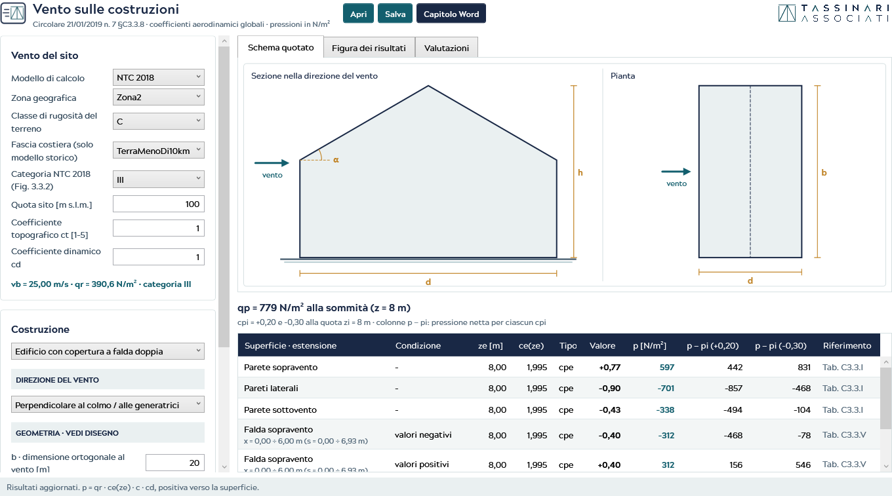
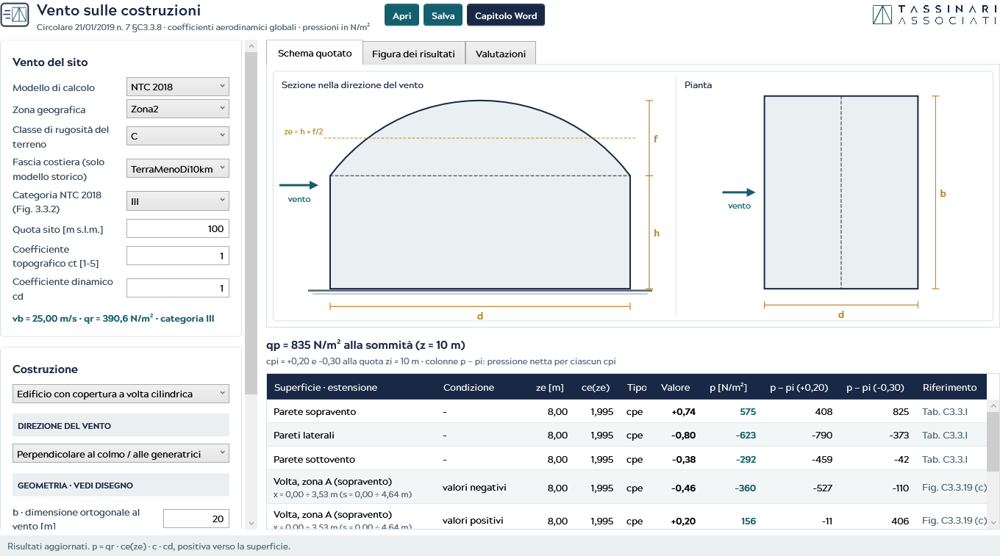
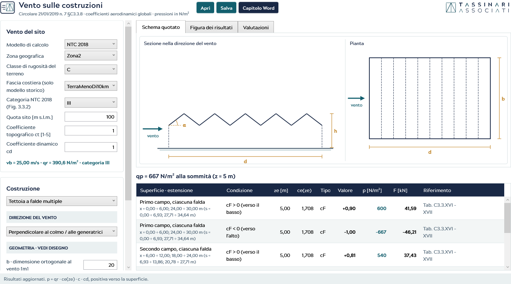
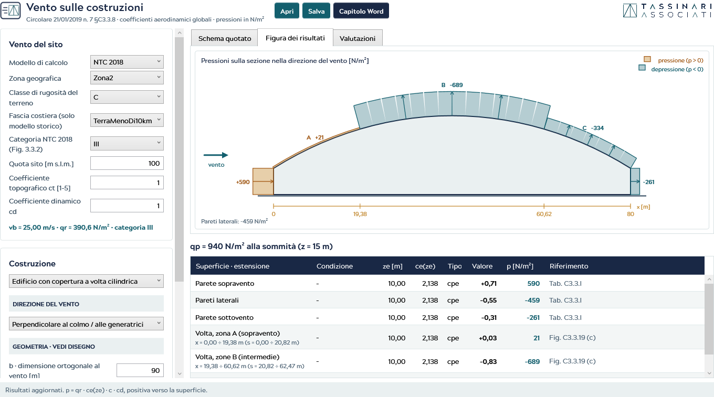
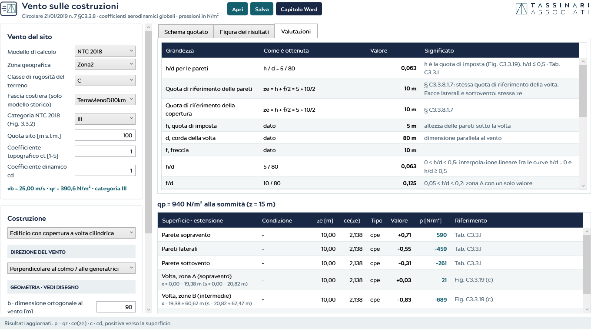
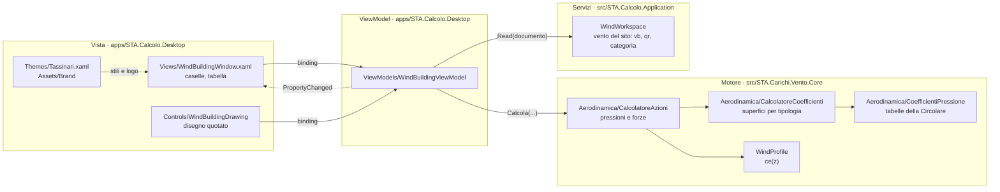
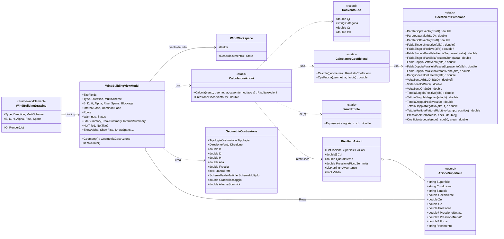
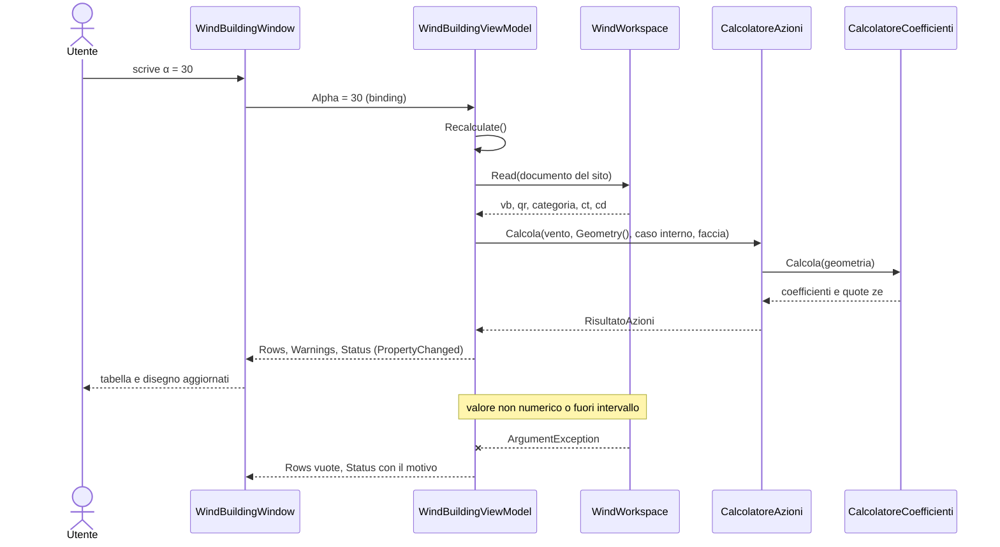
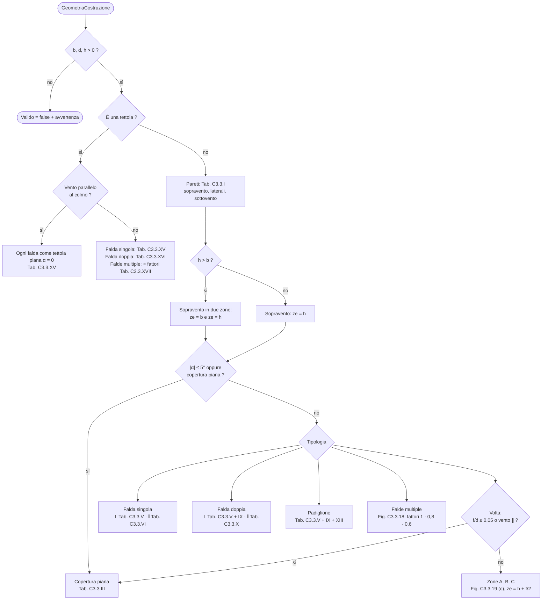
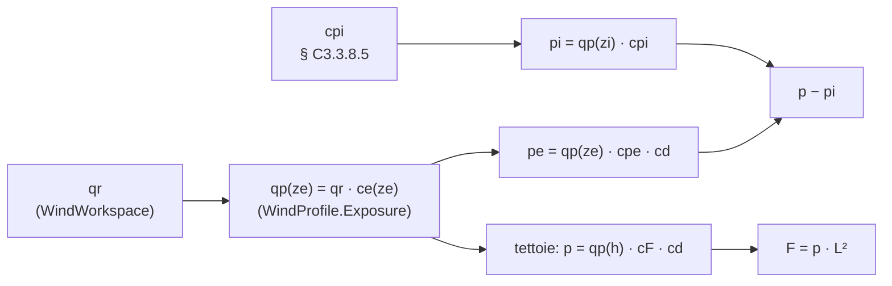

# Vento sulle costruzioni

Modulo **Vento sulle costruzioni** di TA-Calcolo: coefficienti aerodinamici e pressioni del vento su
edifici, coperture e tettoie secondo la **Circolare 21 gennaio 2019 n. 7 C.S.LL.PP., § C3.3.8**
(istruzioni per le NTC 2018). I diagrammi sono in Mermaid e vengono disegnati da GitHub.

- [Cosa fa](#cosa-fa)
- [Architettura (MVVM)](#architettura-mvvm)
- [Classi](#classi)
- [Come si aggiornano i risultati](#come-si-aggiornano-i-risultati)
- [Percorso di calcolo](#percorso-di-calcolo)
- [Metodi e tabelle della Circolare](#metodi-e-tabelle-della-circolare)
- [Dati richiesti per tipologia](#dati-richiesti-per-tipologia)
- [Figura dei risultati ed estensione delle zone](#figura-dei-risultati-ed-estensione-delle-zone)
- [Valutazioni](#valutazioni)
- [Salvare e riaprire i dati](#salvare-e-riaprire-i-dati)
- [Capitolo Word](#capitolo-word)
- [Verifiche](#verifiche)
- [Convenzioni e limiti](#convenzioni-e-limiti)

## Cosa fa

Dalla schermata iniziale si apre la scheda **Vento sulle costruzioni**. A sinistra si inseriscono il
vento del sito (gli stessi campi e la stessa validazione del modulo *Carico vento*) e la geometria;
a destra un **disegno quotato** (sezione e pianta) mostra a quali dimensioni corrispondono i simboli
`b`, `d`, `h`, `α`, `f` delle caselle, e una tabella riporta per ogni superficie:

| Colonna | Significato |
|---|---|
| `ze` | quota di riferimento della superficie [m] |
| `ce(ze)` | coefficiente di esposizione a quella quota |
| Tipo, Valore | coefficiente di pressione esterna `cpe` (edifici) o di forza `cF` (tettoie) |
| `p` | `p = qr · ce(ze) · c · cd` [N/m²] |
| `p − pi` | pressione netta per ciascun valore di `cpi`, se la pressione interna è considerata [N/m²] |
| `F` | forza risultante sulla falda, `F = p · L²` [kN] (solo tettoie) |

Non c'è un pulsante di calcolo: disegno e tabella si aggiornano a ogni carattere digitato.

Sopra la tabella tre schede mostrano lo **schema quotato**, la **figura dei risultati** con le pressioni
disegnate sulla sezione e le **valutazioni** intermedie (h/d, f/d, quote di riferimento, letture). In alto
**Apri** e **Salva** conservano i dati in un file di progetto e **Capitolo Word** esporta la relazione.

## Architettura (MVVM)

Il calcolo sta in una libreria senza interfaccia; la finestra contiene solo XAML e binding.

| Livello | File | Ruolo |
|---|---|---|
| Motore | `src/STA.Carichi.Vento.Core/Aerodinamica/Tipologie.cs` | enumerazioni, `GeometriaCostruzione`, `CoefficienteSuperficie`, `RisultatoCoefficienti` |
| Motore | `src/STA.Carichi.Vento.Core/Aerodinamica/CoefficientiPressione.cs` | una funzione pura per ogni tabella della Circolare |
| Motore | `src/STA.Carichi.Vento.Core/Aerodinamica/CalcolatoreCoefficienti.cs` | sceglie le tabelle in base alla tipologia e compone l'elenco delle superfici |
| Motore | `src/STA.Carichi.Vento.Core/Aerodinamica/CalcolatoreAzioni.cs` | pressioni, pressione interna e forze a partire dal vento del sito |
| Motore | `src/STA.Carichi.Vento.Core/Aerodinamica/Descrizioni.cs` | testi delle enumerazioni, comuni a finestra e relazione |
| Servizi | `src/STA.Calcolo.Application/WindWorkspace.cs` | già esistente: campi, validazione e lettura del vento del sito |
| Servizi | `src/STA.Calcolo.Application/WindBuildingProject.cs` | file di progetto JSON (scrittura, lettura con validazione) e calcolo |
| Relazione | `src/STA.Calcolo.Reporting/WindBuildingReportBuilder.cs` | contenuto del capitolo: testo, tabelle, figure |
| Relazione | `src/STA.Calcolo.Reporting/TemplateChapterWriter.cs`, `ReportChapter.cs` | scrive un capitolo sul modello Word aziendale incorporato (`WordTemplate/TA-Template.dotx`) |
| ViewModel | `apps/STA.Calcolo.Desktop/ViewModels/WindBuildingViewModel.cs` | dati inseriti, ricalcolo a ogni modifica, righe e messaggi |
| Vista | `apps/STA.Calcolo.Desktop/Views/WindBuildingWindow.xaml` | caselle e tabella; il code-behind contiene solo `InitializeComponent` |
| Vista | `apps/STA.Calcolo.Desktop/Controls/WindBuildingDrawing.cs` | disegno di sezione e pianta |
| Vista | `apps/STA.Calcolo.Desktop/Controls/WindPressureDrawing.cs` | figura dei risultati: pressioni sulla sezione e ascisse dei confini fra le zone |
| Servizi | `apps/STA.Calcolo.Desktop/Services/WindBuildingReportService.cs` | rende le figure fuori schermo e produce il .docx |
| Identità | `apps/STA.Calcolo.Desktop/Assets/Brand/VentoCostruzioni.ico` | icona del modulo, dal pittogramma aziendale |
| Vista | `apps/STA.Calcolo.Desktop/Controls/BindingProxy.cs` | porta il ViewModel alle colonne della tabella (intestazioni e visibilità) |
| Avvio | `Services/WindowService.cs`, `ViewModels/MainViewModel.cs` | scheda `vento-costruzione` nella schermata iniziale |

## Classi

## Come si aggiornano i risultati

Ogni casella è legata al ViewModel con `UpdateSourceTrigger=PropertyChanged`. Ogni proprietà, e ogni
campo del vento del sito, richiama `Recalculate()`. Con dati incompleti o fuori campo la tabella si
svuota e la barra di stato riporta il motivo: non restano risultati di un calcolo precedente.

## Percorso di calcolo

`CalcolatoreCoefficienti.Calcola` decide quali tabelle applicare.

Le pressioni sono poi calcolate da `CalcolatoreAzioni`:

## Metodi e tabelle della Circolare

| Metodo di `CoefficientiPressione` | Riferimento | Formula |
|---|---|---|
| `PareteSopravento` | Tab. C3.3.I | h/d ≤ 1: 0,7 + 0,1·h/d; oltre: 0,8 |
| `PareteLaterale` | Tab. C3.3.I | h/d ≤ 0,5: −0,5 − 0,8·h/d; oltre: −0,9 |
| `PareteSottovento` | Tab. C3.3.I | h/d ≤ 1: −0,3 − 0,2·h/d; fino a 5: −0,5 − 0,05·(h/d − 1) |
| `CoperturaPianaFasciaSopravento`, `CoperturaPianaRestantiZone` | Tab. C3.3.III | −0,80 nella fascia min(b/2; h); ±0,20 altrove |
| `FaldaSingolaNegativo` | Tab. C3.3.V | α ≤ −60: −0,5 · fino a −15: −0,5 − (α+60)/90 · fino a 30: −1,0 + (α+15)/75 · fino a 45: −0,4 + (α−30)/37,5 |
| `FaldaSingolaPositivo` | Tab. C3.3.V | 0 ÷ 45: α/75 · 45 ÷ 75: 0,6 + (α−45)/150 |
| `FaldaSingolaParallelaFasciaSopravento` | Tab. C3.3.VI | 0 ÷ 15: −0,8 − α/50 · oltre: −1,10 |
| `FaldaSingolaParallelaRestantiZone` | Tab. C3.3.VI | 0 ÷ 15: −0,2 − α/30 · 15 ÷ 45: −0,7 − (α−15)/150 · oltre: −0,9 + (α−45)/75 |
| `FaldaDoppiaSottovento` | Tab. C3.3.IX | −75 ÷ −15: −0,85 + (α+60)/180 · −15 ÷ 15: −0,6 · 15 ÷ 45: −0,6 + (α−15)/100 · oltre: −0,3 |
| `FaldaDoppiaParallelaFasciaSopravento` | Tab. C3.3.X | −0,8 − \|α\|/150 fino a ±30, poi −1,0 |
| `FaldaDoppiaParallelaRestantiZone` | Tab. C3.3.X | α ≤ −30: −0,9 · fino a 10: −0,9 + (α+30)/100 · oltre: −0,5 |
| `PadiglioneFaldeLaterali` | Tab. C3.3.XIII | 0 ÷ 30: −0,6 − α/75 · 30 ÷ 45: −1,0 · 45 ÷ 60: −1,0 + (α−45)/37,5 · oltre: −0,6 |
| `VoltaZonaA`, `VoltaZonaB`, `VoltaZonaC` | Fig. C3.3.19 (c) | curve del grafico, lette per punti (vedi sotto) |
| `TettoiaSingolaPositivo` / `Negativo` | Tab. C3.3.XV | +0,2 + α/30 · φ=0: −0,5 − 1,3·α/30 · φ=1: −1,4 |
| `TettoiaDoppiaPositivo` / `Negativo` | Tab. C3.3.XVI | +0,2 + 0,7·\|α\|/30 · φ=0: −0,5 + 0,1·α/10 (α ≤ 0), −0,5 − 0,2·α/10 (α ≥ 0) · φ=1: −1,4 |
| `TettoiaMultiplaFattoreRiduttivo` | Tab. C3.3.XVII | cF > 0: 1,0 · 0,9 · 0,7 — cF < 0: 0,8 · 0,7 · 0,7 |
| `PressioneInterna` | § C3.3.8.5 | porosità uniforme: +0,2 e −0,3 · apertura dominante: 0,75·cpe oppure 0,90·cpe |
| `CoefficienteLocale` | formula [C3.3.3] | cpe,1 − (cpe,1 − cpe,10)·log₁₀(A) |

Punti della Fig. C3.3.19 (c) usati per la volta cilindrica:

| Curva | Punti (f/d ; cpe), interpolazione lineare |
|---|---|
| A, h/d = 0 | (0 ; 0) → (0,5 ; +0,8), poi costante |
| A, h/d ≥ 0,5, ramo negativo | (0 ; −0,7) → (0,1 ; −1,2) → (0,2 ; −1,2) → (0,3 ; −0,3) |
| A, h/d ≥ 0,5, ramo positivo | (0,2 ; 0) → (0,5 ; +0,8), poi costante |
| B | (0 ; −0,7) → (0,5 ; −1,2), poi costante |
| C | (0 ; −0,7) → (0,1 ; −0,4), poi costante |

Fra f/d = 0,2 e 0,3 la zona A restituisce **due** valori (entrambi da considerare). Per
0 < h/d < 0,5 si interpola fra la curva h/d = 0 e quelle h/d ≥ 0,5.

## Dati richiesti per tipologia

Le caselle compaiono solo quando servono (proprietà `Show…` del ViewModel).

| Tipologia | b, d, h | α | f | n tratti | tipo costruttivo | direzione | φ | pressione interna |
|---|:-:|:-:|:-:|:-:|:-:|:-:|:-:|:-:|
| Copertura piana | ● | | | | | | | ● |
| Copertura a falda singola | ● | ● | | | | ● | | ● |
| Copertura a falda doppia | ● | ● | | | | ● | | ● |
| Copertura a padiglione | ● | ● | | | | | | ● |
| Copertura a falde multiple | ● | ● | | ● | ● | ● | | ● |
| Copertura a volta cilindrica | ● | | ● | | | ● | | ● |
| Tettoia a falda singola | ● | ● | | | | ● | ● | |
| Tettoia a falda doppia | ● | ● | | | | ● | ● | |
| Tettoia a falde multiple | ● | ● | | ● | | ● | ● | |

## Figura dei risultati ed estensione delle zone

La scheda **Figura dei risultati** disegna la sezione nella direzione del vento con una fascia per ogni zona:
lo spessore è proporzionale a |p|, il colore distingue pressione (ocra, frecce verso la superficie) e
depressione (petrolio, frecce verso l'esterno), e accanto a ogni fascia è scritto il valore in N/m². Sotto la
sezione una linea di quota riporta le ascisse `x` dei confini fra le zone, dal bordo sopravento. Le pareti
laterali, che non stanno nella sezione, sono riportate in una riga di testo. Se la Circolare fornisce due
valori, un elenco sceglie la condizione di carico rappresentata.

Nella tabella, sotto il nome di ogni zona della copertura, compare la sua estensione: `x` è l'ascissa
orizzontale e `s` quella misurata sullo sviluppo della copertura, entrambe dal bordo sopravento.

| Tipologia | Come sono divise le zone |
|---|---|
| Copertura piana, vento parallelo al colmo | fascia sopravento di profondità `min(b/2; h)` (zona A), poi le restanti zone (B) |
| Falda singola e doppia, vento perpendicolare | una zona per falda; `s = x / cos α` |
| Falde multiple | tratti di passo `d/n`; nelle falde con colmi il primo tratto è la sola prima falda |
| Volta cilindrica | quattro zone di uguale sviluppo `L/4`: A, B, B, C, con `L = 2·R·θ`, `R = (d²/4 + f²)/(2f)`, `θ = asin(d/2R)` |
| Tettoie | una zona per falda; la risultante `F` è applicata a `d/4` dal bordo sopravento della falda |
| Padiglione | l'estensione dipende dalla pianta e non è indicata; la figura mostra la sezione di mezzeria |

## Valutazioni

La scheda **Valutazioni** elenca i passaggi che portano ai coefficienti, con la formula o la lettura e il campo
applicato, così ogni risultato si può ricontrollare sulla Circolare. Per la volta cilindrica (§ C3.3.8.1.7):

| Grandezza | Come è ottenuta |
|---|---|
| `h`, `d`, `f` | dati |
| `h/d` | rapporto fra quota di imposta e corda; decide fra curva `h/d = 0`, curve `h/d ≥ 0,5` o interpolazione |
| `f/d` | decide il campo: `≤ 0,05` copertura piana; fino a `0,2` un valore; fra `0,2` e `0,3` due valori; oltre `0,5` fuori grafico |
| `ze` | `h + f/2` |
| `R`, `L`, `L/4` | raggio, sviluppo della volta e sviluppo di ciascuna zona |
| `cpe,A` per `h/d = 0` e per `h/d ≥ 0,5` | letture sulla Fig. C3.3.19 (c) al valore di `f/d` |
| peso dell'interpolazione | `min(h/d; 0,5) / 0,5` |
| `cpe,A` adottato, `cpe,B`, `cpe,C` | valori usati nella tabella dei risultati |

Per le pareti sono indicati `h/d` (per la volta con la quota di imposta `h`) e la quota di riferimento
(per la volta `ze = h + f/2`); per
le altre coperture l'inclinazione con il campo della tabella, la profondità della fascia sopravento e il passo
dei tratti; per le tettoie il grado di bloccaggio e l'area della falda.

Esempio, volta con `b = 90`, `d = 80`, `h = 5`, `f = 10` m: `h/d = 0,0625`, `f/d = 0,125`; la zona A vale `+0,20`
sulla curva `h/d = 0` e `−1,20` su quella `h/d ≥ 0,5`; con peso `0,125` si ottiene
`cpe,A = 0,20 + 0,125·(−1,20 − 0,20) = +0,025`; `cpe,B = −0,825`, `cpe,C = −0,40`. Pareti: `ze = 5 + 10/2 = 10` m,
`h/d = 0,0625`, `cpe = +0,71` sopravento, `−0,55` laterali, `−0,31` sottovento.

## Salvare e riaprire i dati

**Salva** scrive un file `.json` nel formato comune dei moduli (`ModuleDocument`, schema 1, modulo
`vento-costruzione`) con i campi del vento del sito e quelli della costruzione: `tipologia`, `direzione`,
`schema`, `b`, `d`, `h`, `alfa`, `freccia`, `tratti`, `bloccaggio`, `pressioneInterna`, `facciaDominante`.
I numeri sono scritti con il punto decimale. **Apri** valida il file per intero prima di modificare i campi:
un file di un altro modulo, incompleto o con valori fuori campo viene rifiutato con un messaggio nella barra
di stato e il lavoro aperto resta com'era. I risultati non sono salvati: vengono ricalcolati all'apertura.

## Capitolo Word

**Capitolo Word** crea un `.docx` costruito sul modello Word aziendale (copia in
`src/STA.Calcolo.Reporting/WordTemplate/TA-Template.dotx`): usa i suoi stili (Normale, Titolo 1-3 con la
numerazione automatica, Paragrafo elenco, Griglia tabella), l'intestazione con commessa, committente, progetto
e documento e il piè di pagina. Contiene **solo il capitolo** "Azione del vento", senza frontespizio né
sommario, per essere incollato o accodato a una relazione:

1. Normativa e metodo, con le formule come equazioni di Word;
2. Vento del sito;
3. Geometria della costruzione, con lo schema quotato;
4. Coefficienti aerodinamici e pressioni, con la tabella delle valutazioni e quella dei risultati;
5. Distribuzione longitudinale delle zone (`x`, `s`, sviluppo e pressione di ogni tratto);
6. Figura delle pressioni, una per ogni condizione di carico;
7. Avvertenze e limiti.

Il capitolo riporta i risultati mostrati in finestra; le modifiche fatte a mano nel Word non cambiano il
progetto. Se il modello aziendale viene aggiornato va sostituita la copia incorporata.

## Verifiche

| Suite | File | Cosa controlla |
|---|---|---|
| `STA.Calcolo.Tests` | `tests/STA.Calcolo.Tests/WindBuildingTests.cs` | valori letti da tabelle e figure della Circolare e calcolati a mano: pareti, falde, padiglione, volta, tettoie, pressione interna, quote di riferimento, pressioni e forze; estensione delle zone, valutazioni h/d e f/d, file di progetto |
| `STA.Reporting.Tests` | `tests/STA.Reporting.Tests/WindChapterChecks.cs` | capitolo Word: stili del modello, nessun frontespizio o sommario, valutazioni, zone, figure, XML ben formato |
| `STA.Desktop.Smoke` | `tests/STA.Desktop.Smoke/WindBuildingSmoke.cs` | finestra reale: ricalcolo a ogni modifica, colonne dinamiche, disegni, valutazioni, salva e apri, capitolo Word, avvertenze, dati non validi, assenza di errori di binding |

Le immagini di questa pagina sono prodotte dalla prova a video (`artifacts/vento-costruzione*.png`).

## Convenzioni e limiti

- `b` è sempre la dimensione **ortogonale** al vento e `d` quella **parallela**: cambiando direzione
  del vento vanno scambiate, come nelle figure della Circolare.
- `h` è la quota massima della copertura; per la volta è la quota di imposta e la sommità vale `h + f`.
- Sono positive le pressioni dirette verso la superficie; per le tettoie `cF > 0` è verso il basso.
- Segno di `α`: falda singola, positivo con il lato basso sopravento; falda doppia, positivo con
  colmo e negativo con impluvio.
- Dove la Circolare fornisce due valori di segno opposto la tabella riporta due righe ("valori
  negativi" e "valori positivi"): vanno considerate entrambe le condizioni di carico.
- Edifici alti (`h > b`): la parete sopravento è divisa in due zone con `ze = b` e `ze = h`
  (§ C3.3.8.1.1.1, criterio 1).
- Pressione interna: `zi` è la quota di sommità e `cd` non le si applica.
- Vento del sito: valgono modello, intervalli e avvertenze del modulo *Carico vento*
  ([formule](CLIMA-SISMA-FORMULE.md)); quote oltre 200 m sono rifiutate.
- Sono implementati i coefficienti **globali**. I coefficienti locali `cpe,10` e `cpe,1` per zone
  (Tab. C3.3.II, IV, VII, VIII, XI, XII, XIV) non sono tabellati; è disponibile solo la formula di
  interpolazione `CoefficienteLocale`.
- Non sono trattati: edifici a pianta circolare e cupole (§ C3.3.8.3 – C3.3.8.4), travi e tralicci
  (§ C3.3.8.6 – C3.3.8.7), attrito (§ C3.3.8.8). Il coefficiente dinamico `cd` è inserito a mano.
- Fuori dal campo delle tabelle (h/d > 5, |α| > 75°, f/d > 0,5, tettoie oltre i limiti di α) il
  calcolo prosegue con i valori limite e mostra un'avvertenza.
- Per le pareti di un edificio con volta la quota di riferimento è `ze = h + f/2`, la stessa della copertura
  (§ C3.3.8.1.7), e il rapporto `h/d` della Tab. C3.3.I usa la quota di imposta `h` della Fig. C3.3.19.
  La pressione interna resta riferita alla quota di sommità `h + f`.
- La relazione è solo in Word; non è prevista l'esportazione PDF.
